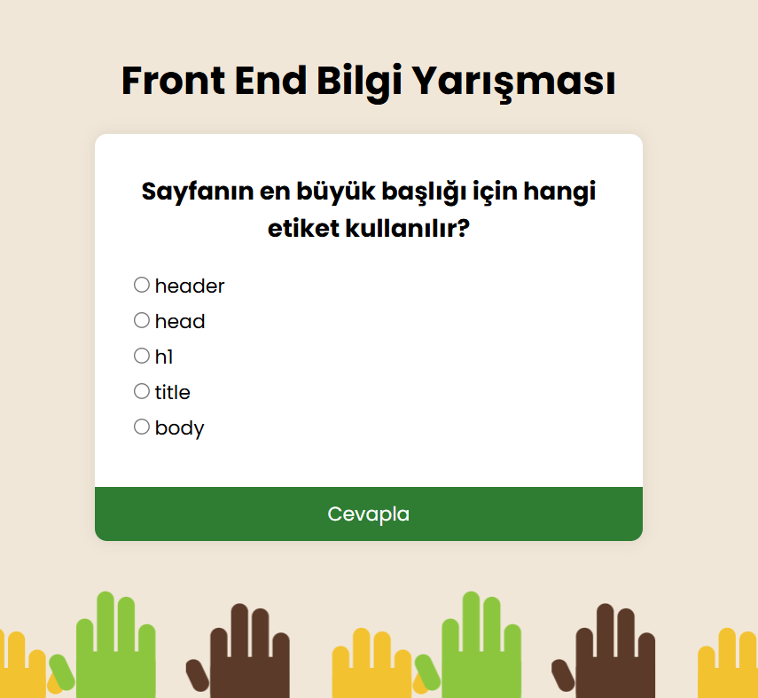

# Front End Quiz

A small quiz app with 5 front-end questions about HTML, CSS and JavaScript. Pick an answer, press **Cevapla** and see your score at the end.

**Live demo:** https://KULLANICI-ADI.github.io/HTML-CSS-JS-Mini-Projects/01-quiz-app/

## Features

- 5 multiple-choice questions loaded from a JavaScript array
- Nothing happens if you press the button without choosing an answer
- Score is counted and shown on a result screen
- Restart button to play again
- Works on small screens

## What I practiced

- Storing data in an array of objects
- Selecting elements with `getElementById` and `querySelectorAll`
- Writing text with `textContent` instead of `innerHTML`
- Reading radio buttons with `forEach` and `.checked`
- Handling clicks with `addEventListener`
- Creating elements with `createElement` and `replaceChildren`
- Flexbox centering and a separate `responsive.css` with a media query
- Working on a feature branch with small commits

## How to run

Open `index.html` in your browser. No build step needed.
